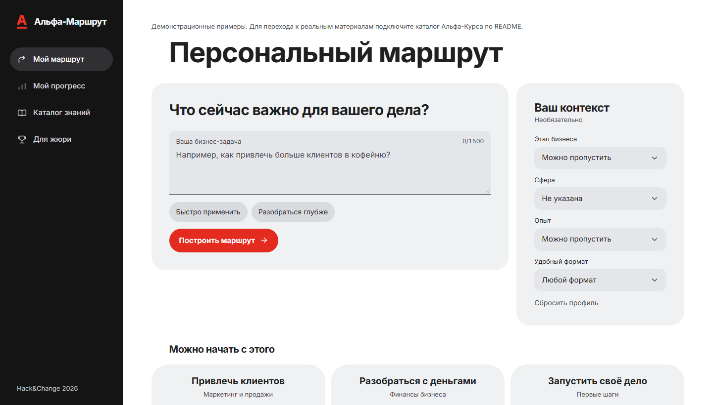

# Альфа-Маршрут 1.2.4

Hack&Change 2026, Альфа-Банк, трек 1. Рекомендательный сервис образовательных материалов для предпринимателя: задача → подходящие материалы → объяснение → следующий практический шаг. Конкурсный прототип, не официальный сервис банка.

**Начните с [полной инструкции для жюри](START_HERE_JURY.md).** В ней точные команды Docker, FULL-импорта, загрузки E5 и Windows Qwen, конфигурация API, проверки и устранение ошибок.

## Быстрый запуск

Нужен Docker Desktop с Linux containers и Compose v2+. Из распакованного корня:

```powershell
docker compose up --build
```

Открыть **http://127.0.0.1:3080**. Swagger: http://127.0.0.1:3080/api/docs. Готовность: `/api/ready`, версия: `/api/health`. Первый build скачивает зависимости из публичных реестров. Python/Node/PostgreSQL отдельно на хосте для этого режима не нужны.

По умолчанию **DEMO:36 авторских синтетических примеров**, без дампа, моделей и API-ключей. Это демонстрация сценариев, а не реальные публикации Альфа-Курса. FULL с каталогом организаторов включается отдельным импортом и overlay; закрытые данные в архив не входят.

Приложение работает с локальным TF-IDF и правилами. Опциональная E5 добавляет нейросетевой сигнал. Локальный Qwen предлагает уточнение задачи, применение подтверждает пользователь. Для показа всех возможностей выполните разделы 4–7 [инструкции](START_HERE_JURY.md).



## Проверка за пять минут

1. Ввести «Хочу привлечь клиентов в кофейню», профиль можно пропустить. Построить маршрут.
2. Проверить причины и следующий шаг. DEMO открывает авторский пример; FULL — официальный источник, если URL известен. Платный доступ обозначен.
3. Отметить «Изучено», перестроить: материал исключён, отметка сохранена в «Мой прогресс» после обновления страницы.
4. На экране «Для жюри» выбрать предпринимателя и сравнить два расчёта. Baseline и personal работают на одинаковом каталоге; score не является метрикой качества.
5. «Помогите с бизнесом» вызывает уточнение. Неполный или отраслево общий результат явно обозначается.

## Состав решения

| Компонент | Назначение |
|---|---|
| Next.js / TypeScript | Интерфейс, каталог, прогресс, диагностика для жюри; proxy `/api/*` |
| FastAPI / Python3.13 | Подбор, объяснения, feedback, импорт завершённых курсов, AI-адаптер |
| PostgreSQL18 | Собственные сессии, профиль и события приложения; отдельная от исходного дампа БД |
| E5 ONNX INT8, опционально | Локальный семантический сигнал,384 измерения; без внешнего inference |
| Qwen1.5B, опционально | Предложение формулировки; не генерирует материалы каталога |

Внешний порт только `127.0.0.1:3080`; API/БД внутри Compose. При занятом порте задайте `WEB_PORT=3090`. `.env` не обязателен для базового запуска; пример настроек — `.env.example`. Ключи и закрытые данные не публикуются.

Опциональные Compose-файлы:

- `compose.full.yaml` — локальный `.private/catalog.json` read-only;
- `compose.semantic.yaml` — заранее загруженные веса E5;
- `compose.llm.yaml` — локальный либо явно разрешённый совместимый API;
- `compose.evaluation.yaml` — подготовленный агрегат оценки, если он есть.

Конкретные команды и переменные — в [START_HERE_JURY.md](START_HERE_JURY.md). Завершение с сохранением данных: `docker compose down`; не добавлять `-v`, если нужен прогресс.

## Документация и сдача

- [Архитектура](docs/architecture.md), [алгоритм](docs/recommendation-pipeline.md), [данные](docs/data-audit.md).
- [Методика оценки](docs/evaluation.md), [план измерения бизнес-эффекта](docs/product-metrics.md), [ограничения](docs/limitations.md).
- [Технические проверки](docs/verification.md), [требования кейса](docs/case-requirements.md), [карта документов](docs/README.md).
- [Готовая PDF-презентация](output/presentation/alfa-route-1.2.pdf), [редактируемый PPTX](output/presentation/alfa-route-1.2.pptx).
- [Точный сценарий необязательной видеозаписи](docs/DEMO_RECORDING.md).

Для Альфа-трека PDF входит в комплект сдачи. Презентация уже подготовлена:9 слайдов, первый содержит репозиторий и порядок проверки. Имя файла содержит minor-версию 1.2; внутри —1.2.4. По предоставленным официальным правилам видео для этого трека не обязательно.

Чистый сдаваемый архив: `alfa-route-1.2.4-submission-clean.zip`, рядом SHA-256. В нём исходники, тесты, фиксированные зависимости, Docker и техническая документация. Локальные конфигурации помощников, внутренние журналы, дамп/каталог/история, модели, ключи и кэши исключены. Опубликованные исторические теги сохраняются; runtime-код соответствует проверенной 1.2.4.
