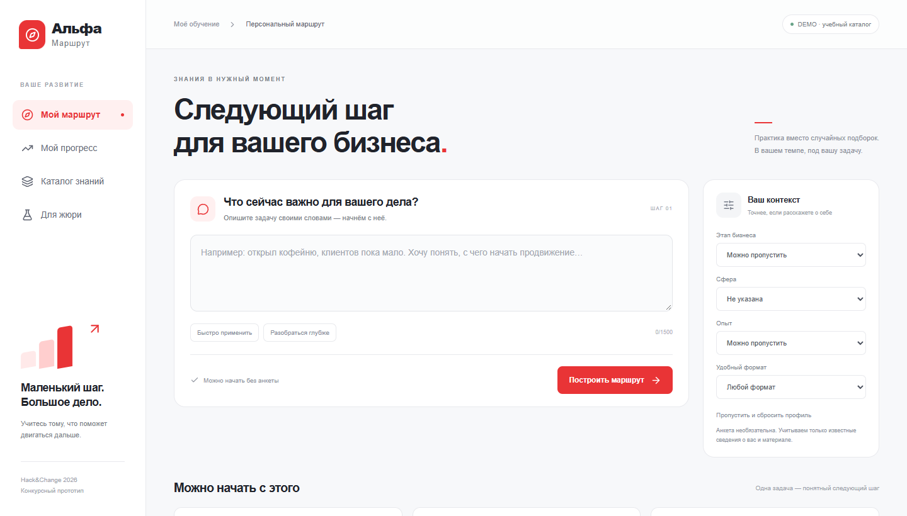

# Альфа-Маршрут

> **v1.2.3 — конкурсный прототип Hack&Change 2026, трек 1.** Персональный маршрут обучения для предпринимателя: задача → материалы → объяснение → следующий шаг.

[](https://github.com/Makasinnnnnn/HackAndChange/actions/workflows/checks.yml)

**Начать:** Docker Desktop → `docker compose up -d --build` → [открыть приложение](http://127.0.0.1:3080). DEMO не требует дампа, модели или API-ключа. Данные прогресса сохраняются в PostgreSQL.

[Изменения](CHANGELOG.md) · [Карта документации](docs/README.md) · [Подключение AI](docs/llm.md) · [Ограничения](docs/release-1.2.3.md)


Конкурсный прототип для Hack&Change 2026, Web/AI от Альфа-Банка. **Трек 1: персональные рекомендации образовательных материалов.** Не официальный сервис банка.

Предприниматель описывает задачу, при желании уточняет контекст и получает последовательность материалов с объяснениями и практическим следующим шагом. Отметки «полезно», «не подходит», «уже знаю» и «изучено» влияют на следующую подборку. Есть каталог, прогресс и сравнение с независимым baseline.



## Запуск для проверки

Нужен работающий Docker Desktop с Linux containers и Compose v2. На Windows не требуется отдельно устанавливать Python, Node или PostgreSQL. Первый запуск скачивает образы и зависимости из публичных реестров. После сборки основной режим не обращается к AI API.

```bash
docker compose up --build
```

Открыть **http://localhost:3080**. Документация API: **http://localhost:3080/api/docs**. Готовность: `/api/ready`. Единственный опубликованный порт — `127.0.0.1:3080`; API и БД доступны внутри сети Compose. `.env` не обязателен. При занятом порте задать `WEB_PORT` в `.env` по `.env.example`.

В стандартном режиме работает **DEMO: 36 авторских синтетических материалов**. Это не настоящие публикации Альфа-Курса. Названия, краткие учебные карточки и профили созданы для проверки прототипа. Нет выдуманных ссылок, рейтингов, цен или длительности. Платные примеры не раскрывают содержание и не предлагают фиктивную покупку.

Остановить с сохранением прогресса: `docker compose down`. Данные приложения остаются в томе `hackandchange_route-db`. Не добавлять `-v`, если прогресс нужно сохранить.

## Проверка за пять минут

1. На главной выбрать «Привлечь клиентов» или ввести бизнес-задачу и нажать «Построить маршрут».
2. Проверить порядок, объяснение и следующий шаг. Открыть материал: в DEMO доступна авторская учебная карточка.
3. Отметить материал «Изучено» и повторно построить маршрут. Освоенный материал исключается. В «Мой прогресс» сохраняется отметка, включая перезагрузку браузера и перезапуск сервисов.
4. В «Для жюри» выбрать предпринимателя, нажать «Сравнить алгоритмы», раскрыть расчёт. Оба алгоритма выполняются на одинаковом запросе и каталоге. Скорость — фактически измеренное время конкретного запроса, не нагрузочный benchmark.
5. Запрос «Помогите с бизнесом» вызывает уточнение. Отсутствующие экспертные метрики показаны как отсутствующие.

Подробнее: [сценарий защиты](docs/demo-script.md), [проверки](docs/verification.md), [ограничения](docs/limitations.md).

## Поиск и персонализация

Baseline использует только текст задачи и тематическую/лексическую релевантность. Основной алгоритм добавляет известные метаданные, формат, срочность, обратную связь и разнообразие. Пройденное, знакомое и нерелевантное исключается. Неизвестные признаки не создаются из воздуха. Цена не повышает score. Нормализованный итоговый score и поправка за разнообразие доступны в диагностике.

По умолчанию: word/character TF-IDF с правилами. Это **лексический**, а не нейросемантический поиск. Дополнительно проверена локальная multilingual E5 small, ONNX INT8 на CPU, 384 измерения. Модель работает локально и не передаёт запросы или каталог провайдеру. Её преимущество на независимой человеческой разметке пока не установлено.

### Опциональная локальная E5

Загрузка публичных весов — отдельный шаг, без ключа. Ревизия и контрольные суммы фиксируются локально. Модель не включена в Git или основной образ.

```bash
docker compose -f compose.yaml -f compose.semantic.yaml --profile models run --rm model-download
docker compose -f compose.yaml -f compose.semantic.yaml up --build
```

Если каталог модели не подготовлен, при загрузке есть ошибка или файлы недоступны, приложение использует лексический fallback. Отсутствие самой папки bind mount потребует сначала выполнить команду загрузки. Для возврата к обычному режиму: `docker compose up -d --build`.

Модель: `Xenova/multilingual-e5-small`, ревизия `761b726dd34fb83930e26aab4e9ac3899aa1fa78`. Источник и ограничения: [описание оригинальной E5](https://huggingface.co/intfloat/multilingual-e5-small), [ONNX-конверсия](https://huggingface.co/Xenova/multilingual-e5-small). Базовая модель имеет MIT-лицензию. Веса не перераспространяются этим репозиторием.

## FULL: закрытый каталог кейса

Дамп не входит в репозиторий, архив сдачи или Docker-образ. Положить предоставленный организаторами `alfa_course_hackathon.backup` в `.private/`. Реальные данные не публиковать.

Архив создан pg_dump 17.6 с PostgreSQL 16.15. pg_restore 16 его не читает. Проверено восстановление утилитой и сервером PostgreSQL 18, закреплёнными по digest. [Аудит](docs/data-audit.md) содержит фактическую схему и агрегаты.

В PowerShell из корня проекта:

```powershell
./scripts/restore_private.ps1
uv venv --python 3.13 .venv
uv pip install --python .venv/Scripts/python.exe -r backend/requirements.txt
.venv/Scripts/python.exe scripts/audit_database.py
.venv/Scripts/python.exe scripts/extract_source_links.py
.venv/Scripts/python.exe scripts/import_catalog.py
docker compose -f compose.yaml -f compose.full.yaml up --build
```

Если аудиторский контейнер уже существует, скрипт остановится, ничего не удаляя. Можно выбрать новое имя `-Container hac-audit-another` и передать его обоим Python-скриптам через `--container hac-audit-another`. Это не рабочая база приложения: сеть отключена, порты не опубликованы, дамп подключён только для чтения, восстановление идёт в tmpfs. Перед восстановлением нового неизвестного дампа изучить его schema-only SQL.

Импорт не читает тела уроков, EmbedItems, IP и пользовательские события. Выгружает только разрешённые краткие метаданные и сохраняет `.private/catalog.json`. Проверено 1 476 строк после фильтров, 1 473 после дедупликации. 507 адресов остаются неподтверждёнными: API возвращает `url=null`, UI объясняет ограничение. Для Articles/Courses пути сопоставлены с публичными страницами, но все ссылки по HTTP ещё не проверены.

FULL + E5: добавить `-f compose.semantic.yaml` к команде после подготовки модели. История исходных пользователей не подключена к браузерной сессии: прогресс приложения — собственные события прототипа. Содержимое исходной БД не меняется.

## Оценка качества

Подготовлены 32 синтетических бизнес-профиля с фиксированным dev/test split. Инструмент формирует слепой пул кандидатов из обоих алгоритмов, без указания происхождения кандидата. Эксперт выставляет 0–3, указывает `label_source=human` и `judge`. Метрики не подставляются, пока меток нет.

```bash
python scripts/evaluate.py prepare
# заполнить .private/evaluation-demo/judgments.csv
python scripts/evaluate.py calculate
```

Для реального каталога: `--full --directory .private/evaluation-full-new`. Для E5 добавить `--semantic`. Создавать новый пул после изменения версии алгоритма; старые результаты не переносить. Не перезаписывает существующую разметку. Смена каталога требует нового пула. Recall считается только по размеченному пулу, а не всему каталогу. [Процедура и ограничения](docs/evaluation.md).

Подключение агрегатного отчёта DEMO к UI: `docker compose -f compose.yaml -f compose.evaluation.yaml up -d`. Этот файл требует заранее подготовленного `.private/evaluation-demo/results.json`. [Бизнес-метрики и A/B-план](docs/product-metrics.md) описывают будущую проверку покупок и возвращаемости. Бизнес-эффект ещё не измерен.

## Проверки и разработка

```bash
python -m pytest -q
ruff check backend scripts
python scripts/check_public_files.py
python scripts/check_version.py
python scripts/smoke.py --base http://127.0.0.1:3080
```

Для локальных команд активировать `.venv` или использовать `.venv/Scripts/python.exe` на Windows. Для unit/API-тестов применяется временный SQLite; работа PostgreSQL отдельно проверяется live smoke на Docker.

Frontend, из `frontend/`:

```bash
npm ci
npm run typecheck
npm run build
npm run test:e2e
```

E2E использует установленный Chrome и запущенный Compose. При его отсутствии: `npx playwright install chrome`. Проверяются desktop и Pixel 7. `E2E_BASE_URL` меняет адрес приложения. Опциональный тест настоящей E5 включается переменной `TEST_SEMANTIC_MODEL_DIR` после установки `backend/requirements-semantic.txt`.

Стек: Next.js 16.4.6, React 19.3.1, FastAPI 0.162.5, SQLAlchemy 2.1.8, scikit-learn 1.9.1, PostgreSQL 18. Полные точные версии — `frontend/package-lock.json`, `backend/requirements.txt`, опциональные `backend/requirements-semantic.txt`. Базовые образы закреплены digest. Lock frontend пересоздан npm 12.2.2 в Node 24.22.3 после проверки совместимости между Windows и Linux. `sharp` и `baseline-browser-mapping` закреплены на проверенных исправленных версиях.

Параметры: `WEB_PORT`, `POSTGRES_PASSWORD` — Compose; `DATABASE_URL`, `CATALOG_MODE`, `CATALOG_PATH`, `SEMANTIC_MODEL_DIR`, `ENABLE_DIAGNOSTICS`, `COOKIE_SECURE`, `EVALUATION_PATH`, `ORT_THREADS` — API. PostgreSQL-пароль по умолчанию предназначен только для изолированного локального демо. При изменении пароля существующего тома нужны отдельные действия в БД, одной смены `.env` недостаточно.

## Документация и готовность

[Статус](docs/STATUS.md) · [план](docs/plan.md) · [требования](docs/case-requirements.md) · [архитектура](docs/architecture.md) · [решения](docs/decisions.md) · [журнал](docs/worklog.md) · [ответы жюри](docs/jury-qa.md).

Актуальный комплект: [PDF](output/presentation/alfa-route-1.2.pdf), [редактируемый PPTX](output/presentation/alfa-route-1.2.pptx), [порядок сдачи](docs/submission.md). Девять слайдов с реальными DEMO-скриншотами; ссылка на репозиторий на первом. Закрытого каталога и моделей в архиве нет. Отправка организаторам и публичный сайт не выполнялись.

## Версия 1.2

Точные границы готовности и проверки: [release-1.2.3.md](docs/release-1.2.3.md). Дополнительный генеративный AI подключается через compose.llm.yaml и явную кнопку с подтверждением; обычный маршрут работает без него. Qwen 1.5B проверен локально через llama.cpp на Windows; веса не входят в Git, инструкция — docs/llm.md.

## Импорт истории обучения

В «Мой прогресс» можно явно выбрать JSON с завершёнными курсами. Формат, подготовка обезличенного тестового сценария из исходной БД и ограничения авторизации: [docs/history.md](docs/history.md). Импорт не раскрывает исходные UserId и не присваивает посетителю чужую историю автоматически.


## Проверка смысла рекомендаций в 1.2

Разобраны [120 авторских запросов](scripts/audit_queries.json) на полном локальном каталоге. По оценке агента: 72 полезные подборки, 28 частичных, 9 пробелов покрытия и 11 ожидаемых уточнений. Это регрессионный аудит, не независимая экспертная оценка; метрики качества и рост конверсии не заявляются. [Полный публичный отчёт](docs/audit-1.2.md) содержит исправления и ограничения; подробные реальные выдачи остаются в .private.

```powershell
.venv/Scripts/python.exe scripts/audit_recommendations.py --output .private/semantic-audit-new/capture.json
```

Набор проверяет ограничения, отрасли, конкретные операции, короткий/ошибочный ввод и посторонние вопросы. Персональная выдача содержит до трёх сильных позиций и честное уточнение, если соответствие не подтверждено. Архитектура: [pipeline v7](docs/recommendation-pipeline.md).

Актуальная проверка v7: [150 бытовых запросов](docs/audit-natural-150.md), 30 ситуаций ×5 сфер, повтор120 прежних; оценки только агента. [Оставшиеся работы](docs/NEXT.md).
