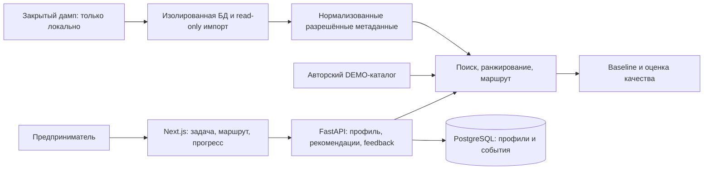

# Архитектура

Согласованная основа: локальный веб-продукт с независимым рекомендательным движком. Ни модель, ни внешнее API не являются обязательным условием запуска.

Три runtime-сервиса: web, api, db. API — модульный монолит. Redis, Kafka, отдельная vector DB, микросервисы и платежи не нужны. Индекс маленького каталога хранится в памяти процесса. Профили и события — в отдельной базе приложения, исходная база организаторов не меняется.

Данные материала: составной ID, тип, заголовок, краткое текстовое описание, исходная ссылка, темы/отрасли/теги, nullable стоимость/длительность/уровень/стадия, статус доступа, происхождение. Синтетические материалы имеют отдельные ID, маркировку DEMO и не выдают выдуманный URL за страницу Альфа-Курса.

Baseline: только тематический/лексический подбор, без профиля. Основной алгоритм: лексические кандидаты + соответствие формату и известным признакам профиля + исключение освоенного/негативного + diversity. Объяснения строятся из активных сигналов. Неопределённый запрос вызывает уточнение. Семантика позже подключается адаптером и сравнивается с lexical fallback.

Плюсы: воспроизводимость, независимость от ключей, прозрачная диагностика, приватность. Минусы: лексический поиск хуже понимает перефразирование; полноценные offline-метрики зависят от человеческой разметки; платный/подписочный доступ требует осторожного импорта.

Альтернативы: React/Vite проще для одной SPA, но Next.js соответствует пожеланию владельца и даёт единый origin через proxy. Внешняя LLM проще для перефразирования, но добавляет передачу данных, ключи и нестабильность. Чистая LLM не используется как весь рекомендательный алгоритм.

Запуск: проверенный `docker compose up --build`, локальный порт UI 3080 и закрытая сеть к API/БД. FULL-импорт подключает закрытый файл только read-only mount; он не попадает в build context. Runtime — PostgreSQL 18 по закреплённому digest. Образы Node/Python также закреплены digest. Зависимости и код размещены отдельными слоями, чтобы изменение приложения не вызывало повторное скачивание пакетов.

Опциональный E5 использует ONNX INT8 на CPU, закреплённую ревизию, attention-mask pooling и нормализованные векторы. Веса загружаются отдельно, затем работают локально через read-only mount. Ошибка загрузки или построения семантического индекса включает лексический fallback. Профиль, запрос и каталог не отправляются провайдеру модели.
